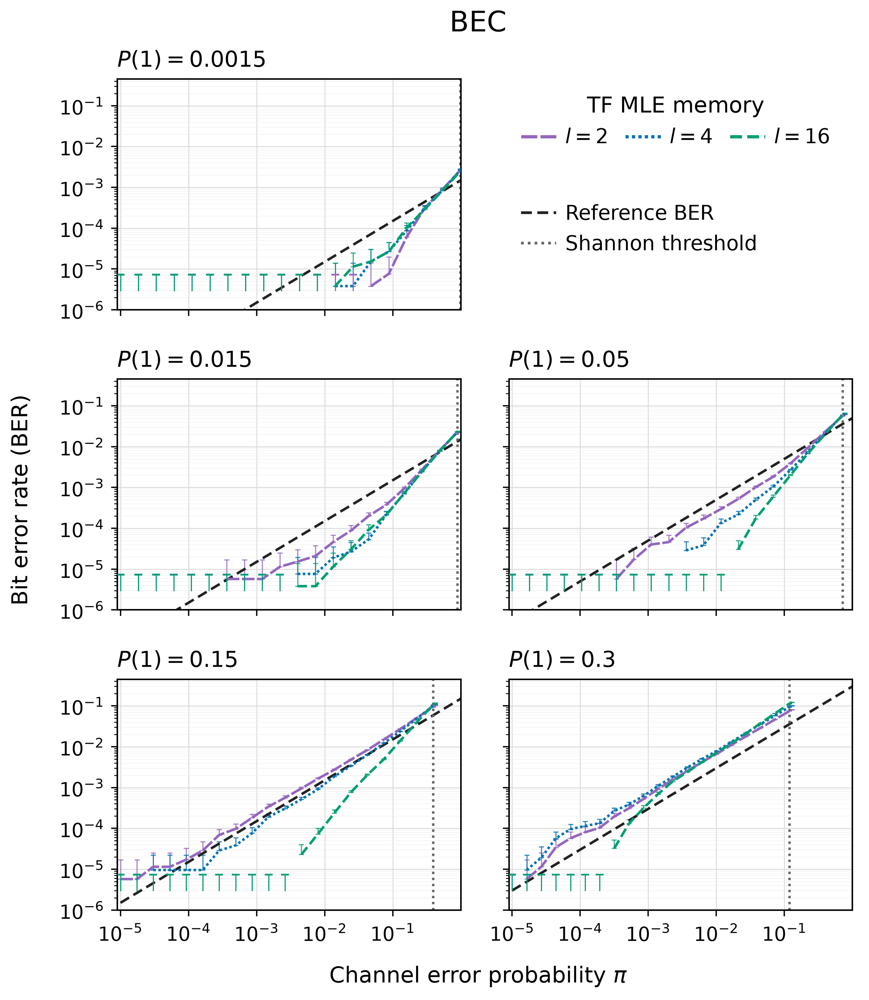
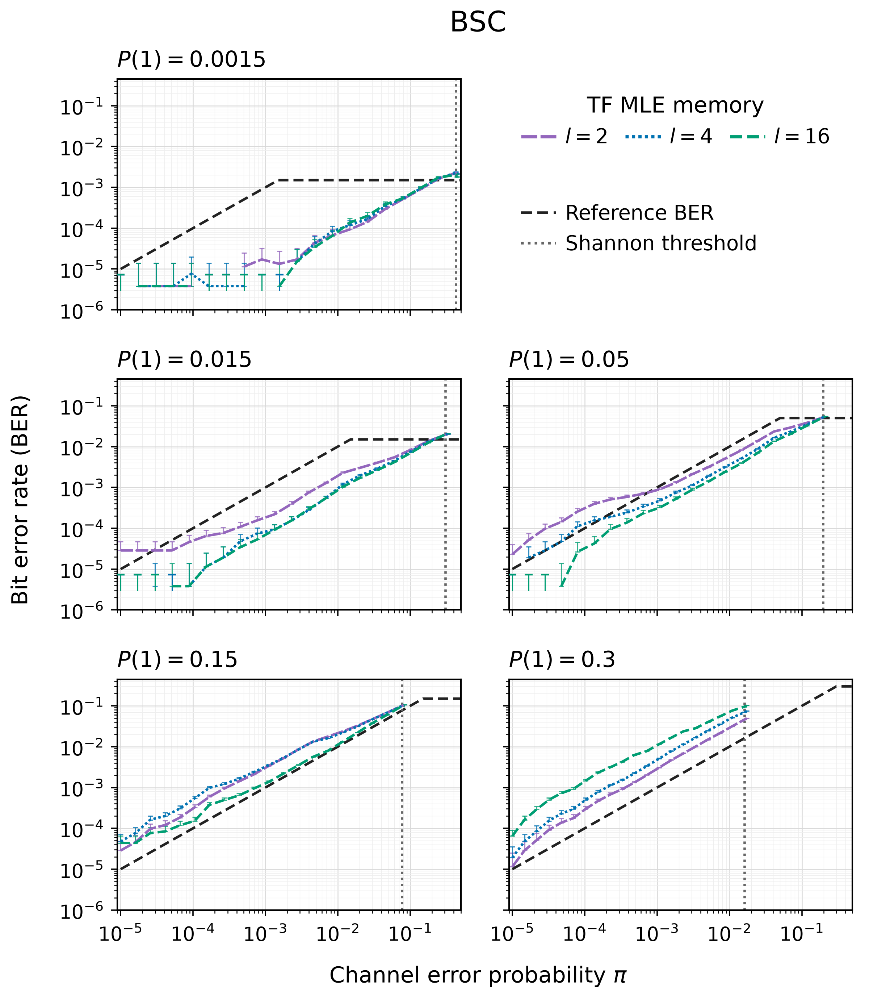

# Error-correcting codes without parity-check bits

The raw experiments results for both BSC and BEC is in [data/tf-mle-grid-256x2048.csv](data/tf-mle-grid-256x2048.csv).

| BEC | BSC |
| :---: | :---: |
|  |  |
